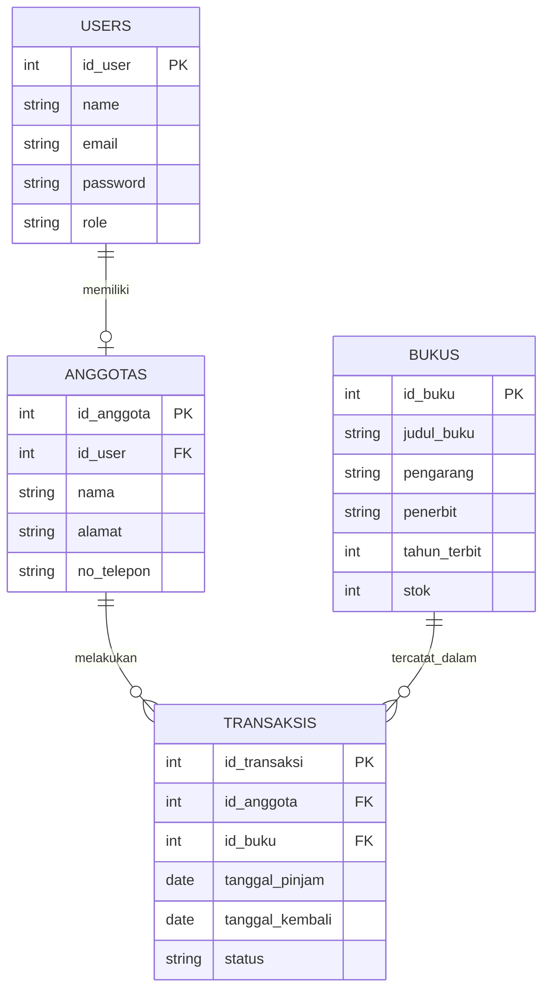
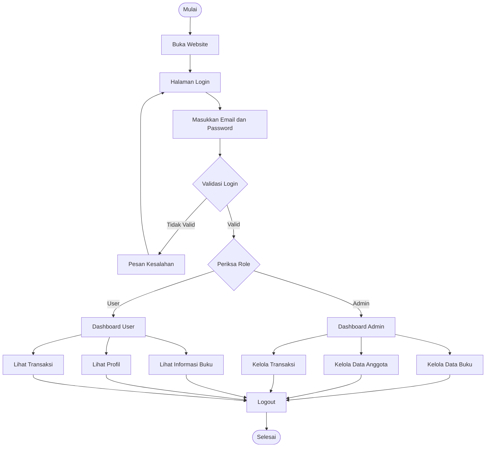
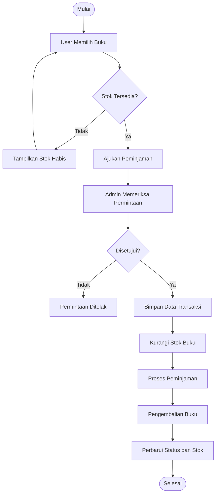

# 📚 SISTEM INFORMASI PERPUSTAKAAN DIGITAL

<p align="center">
  
  
  
  
</p>

<p align="center">
  <b>Aplikasi Perpustakaan Digital Berbasis Website</b><br>
  Dibangun untuk memenuhi tugas Uji Kompetensi Keahlian (UKK).
</p>

---

## 🌐 Informasi Website

| Keterangan | Detail |
|---|---|
| Nama Project | Sistem Informasi Perpustakaan Digital |
| Nama Pengembang | Dyan |
| Kelas | XI TI |
| Sekolah | SMK Muhammadiyah 2 Bantul |
| Framework | Laravel |
| Database | MySQL |
| Bahasa Pemrograman | PHP |
| Repository | [GitHub UKK_Dyan](https://github.com/dyanpro206-a11y/UKK_Dyan) |
| Website | [Kunjungi Website](https://dyanpro206-a11y.github.io/UKK_Dyan/) |

---

## 📖 1. Tentang Aplikasi

Sistem Informasi Perpustakaan Digital merupakan aplikasi berbasis website yang dirancang untuk membantu proses pengelolaan data perpustakaan secara digital.

Aplikasi ini bertujuan untuk mempermudah pengelolaan data buku, data anggota, pengguna, serta transaksi peminjaman dan pengembalian buku.

Dengan adanya sistem ini, proses administrasi perpustakaan diharapkan menjadi lebih terstruktur, efektif, dan mudah digunakan.

### 🎯 Tujuan Pembuatan

1. Mempermudah pengelolaan data buku.
2. Mempermudah pendataan anggota perpustakaan.
3. Mengelola transaksi peminjaman dan pengembalian buku.
4. Mempermudah admin dalam mengelola informasi perpustakaan.
5. Mengurangi pencatatan data secara manual.

---

## ✨ 2. Fitur Aplikasi

### 👨‍💻 Admin

- Login administrator.
- Dashboard pengelolaan perpustakaan.
- Mengelola data buku.
- Mengelola data anggota.
- Mengelola data pengguna.
- Mengelola transaksi peminjaman.
- Mengelola pengembalian buku.
- Melihat data dan informasi perpustakaan.

### 👤 User / Anggota

- Login pengguna.
- Melihat informasi buku.
- Melihat profil pengguna.
- Melihat informasi transaksi.
- Mengakses layanan perpustakaan sesuai hak akses.

*Catatan: Fitur mengikuti rancangan aplikasi dan perlu disesuaikan dengan fitur yang benar-benar sudah diimplementasikan.*

---

## 🛠️ 3. Teknologi yang Digunakan

| Teknologi | Kegunaan |
|---|---|
| Laravel | Framework pengembangan website |
| PHP | Bahasa pemrograman backend |
| MySQL | Database penyimpanan data |
| HTML | Membuat struktur halaman |
| CSS | Mengatur tampilan website |
| JavaScript | Membuat interaksi website |
| Bootstrap | Membantu desain antarmuka |
| Git | Mengelola versi kode |
| GitHub | Menyimpan repository project |
| Laragon | Menjalankan server lokal |

---

## 🗄️ 4. Perancangan Database

Database dirancang untuk menghubungkan data pengguna, anggota, buku, dan transaksi sehingga pengelolaan informasi perpustakaan dapat dilakukan secara terstruktur.

### Entitas Database

**1. Pengguna (Users)**
- id_user (Primary Key)
- name
- email
- password
- role

**2. Anggota (Anggotas)**
- id_anggota (Primary Key)
- id_user (Foreign Key)
- nama
- alamat
- no_telepon

**3. Buku (Bukus)**
- id_buku (Primary Key)
- judul_buku
- pengarang
- penerbit
- tahun_terbit
- stok

**4. Transaksi (Transaksis)**
- id_transaksi (Primary Key)
- id_anggota (Foreign Key)
- id_buku (Foreign Key)
- tanggal_pinjam
- tanggal_kembali
- status

### 📊 ERD (Entity Relationship Diagram)



### Penjelasan Relasi

| Relasi | Penjelasan |
|---|---|
| Users - Anggotas | Satu pengguna dapat memiliki satu data anggota |
| Anggotas - Transaksis | Satu anggota dapat melakukan banyak transaksi |
| Bukus - Transaksis | Satu buku dapat tercatat dalam banyak transaksi |

---

## 🔄 5. Flowchart Sistem

Flowchart menggambarkan alur kerja aplikasi mulai dari pengguna membuka website, melakukan login, hingga menggunakan fitur sesuai hak akses.

### Flowchart Login dan Penggunaan Sistem



### Alur Transaksi Peminjaman Buku



---

## ⚙️ 6. Cara Instalasi Project

Ikuti langkah berikut untuk menjalankan aplikasi di komputer lokal.

### Persyaratan

- PHP
- Composer
- MySQL
- Laragon
- Git
- Web Browser

### Langkah Instalasi

**1. Clone Repository**

```bash
git clone https://github.com/dyanpro206-a11y/UKK_Dyan.git
```

**2. Masuk ke Folder Project**

```bash
cd UKK_Dyan
```

**3. Install Dependency**

```bash
composer install
```

**4. Salin File Environment**

```bash
cp .env.example .env
```

Jika menggunakan Windows, file `.env.example` juga bisa disalin secara manual menjadi `.env`.

**5. Generate Application Key**

```bash
php artisan key:generate
```

**6. Atur Database**

Buka file `.env`, kemudian sesuaikan konfigurasi database:

```env
DB_CONNECTION=mysql
DB_HOST=127.0.0.1
DB_PORT=3306
DB_DATABASE=ukk_dyan
DB_USERNAME=root
DB_PASSWORD=
```

Buat database dengan nama `ukk_dyan` melalui phpMyAdmin.

**7. Jalankan Migration**

```bash
php artisan migrate
```

Jika project menggunakan seeder:

```bash
php artisan db:seed
```

**8. Jalankan Aplikasi**

```bash
php artisan serve
```

Buka browser dan akses:

```text
http://127.0.0.1:8000
```

---

## 📁 7. Struktur Folder Laravel

```text
UKK_Dyan/
│
├── app/
│   ├── Http/
│   │   ├── Controllers/
│   │   └── Middleware/
│   │
│   └── Models/
│
├── bootstrap/
├── config/
├── database/
│   ├── migrations/
│   ├── seeders/
│   └── factories/
│
├── public/
│   ├── css/
│   ├── js/
│   └── images/
│
├── resources/
│   └── views/
│
├── routes/
│   └── web.php
│
├── storage/
├── tests/
├── .env.example
├── artisan
├── composer.json
└── README.md
```

---

## 🔐 8. Keamanan Sistem

Beberapa aspek keamanan yang diterapkan atau direncanakan:

- Autentikasi login pengguna.
- Pembagian hak akses Admin dan User.
- Validasi data yang dimasukkan.
- Penyimpanan password menggunakan hashing Laravel.
- Penggunaan CSRF Protection.
- Pembatasan akses halaman berdasarkan role.

---

## 🚀 9. Pengembangan Selanjutnya

Beberapa pengembangan yang dapat dilakukan:

1. Menambahkan fitur pencarian buku.
2. Menambahkan laporan transaksi.
3. Menambahkan fitur cetak laporan.
4. Menambahkan notifikasi peminjaman.
5. Menambahkan riwayat peminjaman.
6. Meningkatkan tampilan agar lebih responsif.
7. Meningkatkan keamanan dan performa aplikasi.

---

## 👨‍🎓 10. Identitas Pengembang

**Nama:** Dyan  
**Kelas:** XI TI  
**Sekolah:** SMK Muhammadiyah 2 Bantul  
**Program Keahlian:** Pengembangan Perangkat Lunak dan Gim (PPLG)

**Project:** Sistem Informasi Perpustakaan Digital

**Tujuan:** Memenuhi tugas Uji Kompetensi Keahlian (UKK) sebagai bentuk penerapan keterampilan dalam pengembangan aplikasi berbasis website.

---

## 📌 11. Penutup

Sistem Informasi Perpustakaan Digital ini dibuat sebagai bentuk penerapan ilmu pemrograman web, pengelolaan database, dan pengembangan aplikasi menggunakan framework Laravel.

Diharapkan aplikasi ini dapat membantu proses pengelolaan perpustakaan menjadi lebih mudah, terstruktur, dan efisien.

---

<p align="center">
  <b>© 2026 Dyan - UKK SMK Muhammadiyah 2 Bantul</b><br>
  <i>Built with Laravel ❤️</i>
</p>
