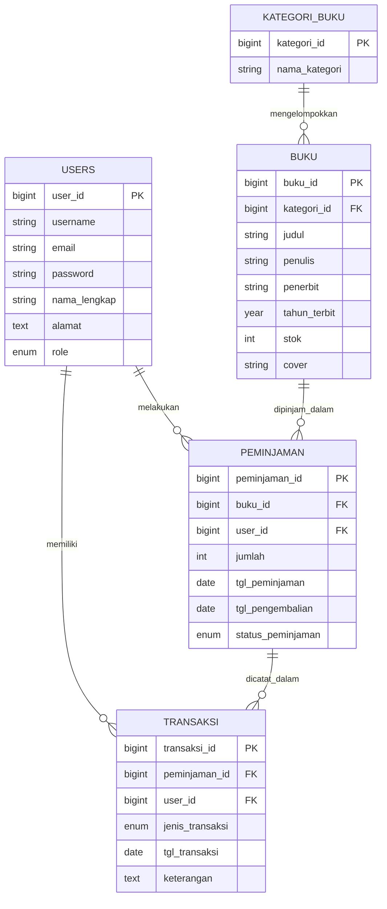
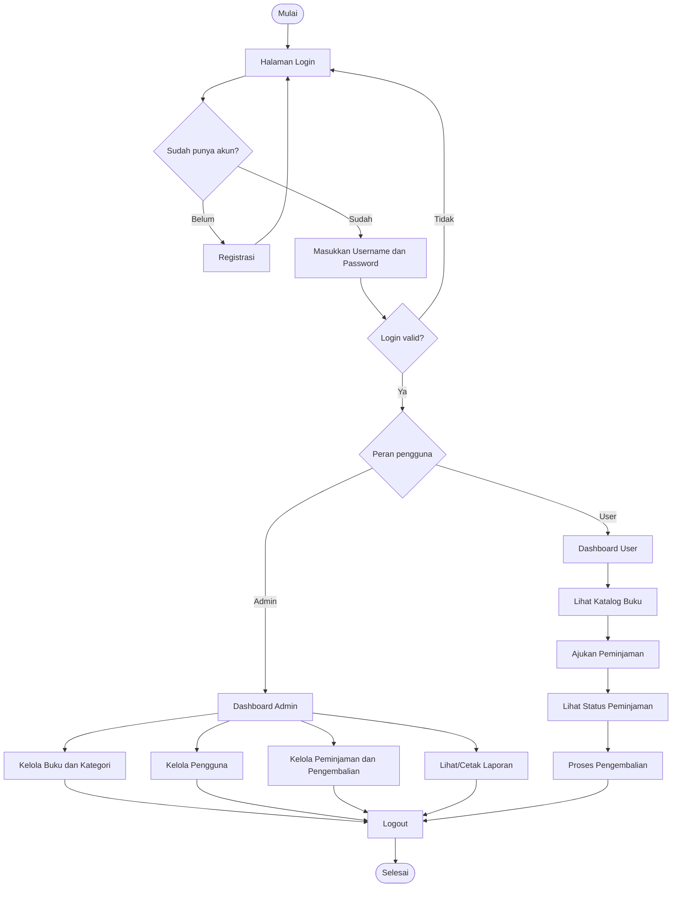

# 📚 Perpustakaan Digital — UKK Dyan

<p align="center">
  <strong>Aplikasi Pengelolaan Perpustakaan Berbasis Web</strong><br>
  Dibangun menggunakan Laravel 10, PHP, dan MySQL.
</p>

<p align="center">
  <a href="https://github.com/dyanpro206-a11y/UKK_Dyan">Repository GitHub</a>
</p>

---

## 📖 Tentang Project

**Perpustakaan Digital** adalah aplikasi berbasis web untuk membantu proses pengelolaan perpustakaan, mulai dari pendataan buku dan kategori, pengelolaan anggota, peminjaman, pengembalian, hingga pencatatan transaksi dan laporan.

Aplikasi memiliki dua jenis hak akses, yaitu **Admin** dan **User/Anggota**. Setiap jenis akun memiliki halaman dan menu sesuai dengan perannya.

## ✨ Fitur Aplikasi

### Admin
- Login khusus admin.
- Dashboard admin.
- Mengelola data buku (tambah, lihat, ubah, dan hapus).
- Mengelola kategori buku.
- Mengelola akun pengguna.
- Mengelola data peminjaman.
- Memproses dan mengelola pengembalian buku.
- Melihat riwayat transaksi.
- Melihat dan mencetak laporan.

### User / Anggota
- Registrasi dan login pengguna.
- Dashboard anggota.
- Melihat katalog dan detail buku.
- Melakukan peminjaman buku.
- Melihat data peminjaman sendiri.
- Mengajukan/mengelola proses pengembalian sesuai fitur aplikasi.
- Melihat dan memperbarui profil.

## 🧰 Teknologi

| Teknologi | Kegunaan |
|---|---|
| PHP 8.1 atau lebih baru | Bahasa pemrograman backend |
| Laravel 10 | Framework aplikasi web |
| MySQL | Database |
| Blade | Template halaman Laravel |
| HTML, CSS, JavaScript | Tampilan dan interaksi antarmuka |
| Vite | Build asset frontend |
| Cloudinary Laravel | Integrasi pengelolaan gambar/cover buku (jika dikonfigurasi) |

## 🗂️ Struktur Folder

```text
UKK_Dyan/
├── app/
│   ├── Http/Controllers/   # Controller aplikasi
│   └── Models/             # Model dan relasi database
├── bootstrap/
├── config/                 # Konfigurasi Laravel dan layanan
├── database/
│   ├── migrations/         # Struktur tabel database
│   └── seeders/            # Data contoh
├── public/                 # File publik dan entry point
├── resources/
│   └── views/              # Tampilan Blade
├── routes/
│   └── web.php             # Routing aplikasi
├── storage/
├── tests/
├── .env.example
├── artisan
├── composer.json
├── package.json
└── README.md
```

## 🧑‍💻 Instalasi dan Menjalankan Project

### Persyaratan

Pastikan perangkat sudah memiliki:
- PHP 8.1+ dan ekstensi PHP yang dibutuhkan Laravel.
- Composer.
- MySQL/MariaDB.
- Node.js dan NPM.
- Git (opsional, untuk clone repository).

### 1. Clone repository

```bash
git clone https://github.com/dyanpro206-a11y/UKK_Dyan.git
cd UKK_Dyan
```

### 2. Install dependency PHP

```bash
composer install
```

### 3. Siapkan file environment

Salin `.env.example` menjadi `.env` (di Windows, bisa menyalinnya melalui File Explorer):

```bash
cp .env.example .env
```

Buat database baru melalui phpMyAdmin atau MySQL, misalnya dengan nama `ukk_dyan`. Kemudian sesuaikan konfigurasi database pada file `.env`:

```env
APP_NAME="Perpustakaan Digital"
APP_ENV=local
APP_DEBUG=true
APP_URL=http://127.0.0.1:8000

DB_CONNECTION=mysql
DB_HOST=127.0.0.1
DB_PORT=3306
DB_DATABASE=ukk_dyan
DB_USERNAME=root
DB_PASSWORD=
```

Sesuaikan username dan password dengan konfigurasi MySQL di komputer masing-masing.

### 4. Generate application key

```bash
php artisan key:generate
```

### 5. Jalankan migration

```bash
php artisan migrate
```

Jika ingin mengisi database dengan data contoh dari seeder, jalankan:

```bash
php artisan db:seed
```

> Perintah seeder menambahkan data contoh ke database. Gunakan hanya pada database pengembangan atau database yang memang disiapkan untuk data demo.

### 6. Siapkan penyimpanan file

```bash
php artisan storage:link
```

### 7. Install dan build asset frontend

```bash
npm install
npm run build
```

### 8. Jalankan aplikasi

```bash
php artisan serve
```

Buka alamat berikut di browser:

```text
http://127.0.0.1:8000
```

## 🗃️ Database dan ERD

Database utama aplikasi menggunakan tabel `users`, `kategori_buku`, `buku`, `peminjaman`, dan `transaksi`. Relasi berikut disusun berdasarkan migration dan model pada project.



### Penjelasan Relasi

- **Users — Peminjaman:** satu pengguna dapat memiliki banyak data peminjaman.
- **Users — Transaksi:** satu pengguna dapat tercatat pada banyak transaksi.
- **Kategori Buku — Buku:** satu kategori dapat memiliki banyak buku.
- **Buku — Peminjaman:** satu buku dapat muncul pada banyak data peminjaman.
- **Peminjaman — Transaksi:** satu peminjaman dapat memiliki beberapa catatan transaksi.

## 🔄 Flowchart Alur Aplikasi



## 🔐 Pembagian Hak Akses

| Bagian | Admin | User |
|---|:---:|:---:|
| Dashboard sesuai role | ✅ | ✅ |
| Melihat katalog buku | ✅ | ✅ |
| Mengelola data buku | ✅ | — |
| Mengelola kategori | ✅ | — |
| Mengelola akun pengguna | ✅ | — |
| Mengelola seluruh peminjaman | ✅ | — |
| Mengajukan peminjaman sendiri | — | ✅ |
| Melihat peminjaman sendiri | — | ✅ |
| Mengakses profil sendiri | — | ✅ |
| Laporan perpustakaan | ✅ | — |

## ⚙️ Konfigurasi Tambahan

Project memiliki konfigurasi Cloudinary untuk pengelolaan cover buku. Jika fitur tersebut digunakan, isi variabel Cloudinary yang diperlukan pada `.env` sesuai akun Cloudinary milik sendiri. Jangan memasukkan API secret ke repository publik.

## 🌐 Repository dan Deployment

- **GitHub Repository:** https://github.com/dyanpro206-a11y/UKK_Dyan
- **GitHub Pages Settings:** https://github.com/dyanpro206-a11y/UKK_Dyan/settings/pages

**Catatan deployment:** GitHub Pages hanya melayani website statis (HTML, CSS, dan JavaScript), sehingga tidak dapat menjalankan backend Laravel atau database MySQL. Untuk menjalankan aplikasi Laravel secara online, gunakan hosting/server yang mendukung PHP dan MySQL, lalu atur document root ke folder `public` Laravel.

## 👨‍🎓 Identitas Project

| Keterangan | Informasi |
|---|---|
| Nama Project | Perpustakaan Digital |
| Nama Pengembang | Dyan |
| Kegiatan | Uji Kompetensi Keahlian (UKK) |
| Framework | Laravel 10 |
| Database | MySQL |

---

<p align="center">
  Dibuat untuk Project Uji Kompetensi Keahlian (UKK).<br>
  <strong>Perpustakaan Digital — UKK Dyan</strong>
</p>
```

---

**Lisensi dan penggunaan:** project ini dibuat untuk kebutuhan pembelajaran dan pengembangan aplikasi perpustakaan.
